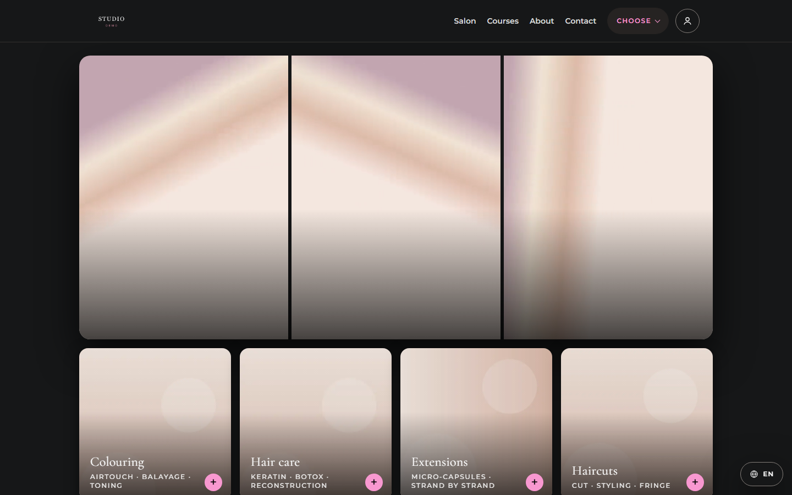
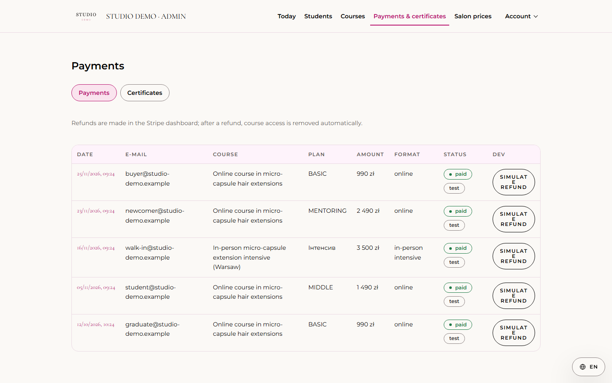
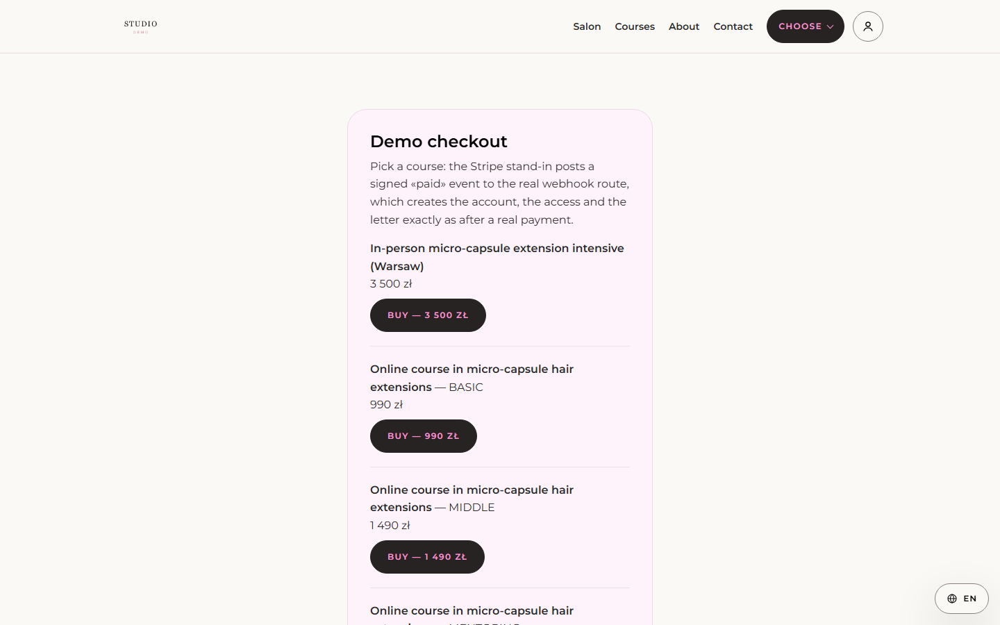

# Salon Academy Demo — beauty salon website with a paid online academy

[](https://github.com/Oparavitalii/salon_academy_demo/actions/workflows/ci.yml)

Public copy of a production system: a beauty-salon website with a paid online academy (course shop,
student area, admin panel), built and run for a real client. Names and data replaced with demo ones.

I (Vitalii Opara) designed and built it alone, end to end. The code matches production; the brand,
people, photos, videos, contacts and data are fictional, external services are optional, and the git
history starts fresh (see [What changed for the public demo](#what-changed-for-the-public-demo)).

- **Run it locally with zero accounts:** `npm install && npm run demo` → http://localhost:3000
- **Demo logins** (password `demo-studio-2026` for all):
  - `admin@studio-demo.example` — admin panel
  - `student@studio-demo.example` — student halfway through the online course
  - `graduate@studio-demo.example` — finished the course, has a certificate
  - `newcomer@studio-demo.example` — just bought the course



## What it does

- **Salon site:** services with price lists per direction, team, studio life, reviews, booking channels, a map loaded only on click (no third party before consent)
- **Course shop:** online courses with tiers and in-person intensives; Stripe Checkout (BLIK, Przelewy24, cards, Apple / Google Pay); the price always comes from the database, never from the form
- **Student area:** the course with its lessons, «watched» progress, signed lesson video, downloadable materials, certificates, settings and help
- **Automatic certificates:** the last watched lesson issues a numbered PDF certificate (pdf-lib) and e-mails it; the PDF is never stored, it is rebuilt from its row
- **Admin panel:** today's overview, students (search, manual enrolment, block / unblock, resend access), login log with suspicious-login flags, payments with refunds, certificates, course and salon prices
- **Multilingual:** Ukrainian, Polish and English (next-intl), a cookie banner with consent categories, privacy policy pages

Course page:


Student area:


Admin panel (payments):



Demo checkout:



## Architecture

```
Browser
  │
Next.js 16 App Router (React 19 server components, server actions)
  ├── proxy.ts ─ locale routing (next-intl) + JWT role gate for /cabinet, /admin
  ├── Auth.js v5 (Credentials) ─ bcrypt, one active session row per user, DB rate limits, login log
  ├── Drizzle ORM ─ PostgreSQL (Neon serverless driver in production; PGlite in tests and the demo)
  ├── Checkout server action ─ Stripe Checkout Session (price read from the DB)
  │        │
  │   Stripe ──► POST /api/webhooks/payments
  │                 ├─ signature check (stripe.webhooks.constructEvent)
  │                 ├─ event-id claim in webhook_events (processing → done, re-takeable after 5 min)
  │                 └─ idempotent fulfilment: account → enrolment → one access letter
  │                     refund / dispute → access revoked
  ├── Resend ─ access, reset, certificate and admin letters (dev / demo: .dev_outbox/)
  ├── Bunny Stream ─ lesson video through signed, expiring embed URLs (the key never leaves the server)
  └── pdf-lib + fontkit ─ certificate PDF from a template, generated on request
```

## Engineering highlights

- **Payments you can retry safely.** The webhook verifies the Stripe signature, claims the event id before doing any work (a parallel or repeated delivery is acknowledged and skipped), and the fulfilment is idempotent: one account, one enrolment, one access letter, even when Stripe retries after a crash halfway. The buyer's letter has its own short-lived claim, so a retry never sends it twice and a failed send shows up in the admin as «paid, no letter». Refunds and disputes revoke access; a partial refund keeps it
- **No fake sales.** Buy buttons only appear when a checkout can really complete (provider configured, live key, e-mail delivery working); a Stripe test key on the real domain grants nothing unless the payer is allow-listed
- **Sessions and abuse protection.** One active session per account (a new login ends the old one, so a course login cannot be shared), throttling stored in Postgres by IP and by e-mail, equal-time answers for unknown e-mails, single-use SHA-256-hashed reset tokens, and a login log with device, offline GeoIP and a «suspicious» flag for a new country within 24 h
- **Private video.** Lesson pages embed Bunny Stream with a SHA-256 token valid for one hour; access is checked on the server for every lesson and material download
- **Tests against real SQL.** The Vitest suite runs the app's real Drizzle migrations in an in-process Postgres (PGlite): the webhook route, fulfilment, refunds, auth, access rules and admin actions run their actual queries, with no external service
- **Production hygiene.** Security headers, `no-store` on private pages, `www` → apex redirect, a Docker standalone build on Fly.io with migrations as a release command, and encrypted nightly backups with a restore drill (`.github/workflows/Db_Backup.yml`, `Restore_Drill.yml`, kept here as manual-only references)

## Stack

TypeScript · Next.js 16 (App Router) · React 19 · Tailwind CSS 4 · Auth.js v5 · Drizzle ORM ·
PostgreSQL (Neon) · PGlite · Stripe · Resend · Bunny Stream · pdf-lib · next-intl · Zod · Three.js ·
hls.js · Vitest · Playwright + axe-core · GitHub Actions · Docker · Fly.io

## Project structure

```
app/[locale]/        pages: salon site, courses, checkout, cabinet (student area), admin
app/api/             payment webhook, certificates, lesson materials, auth, health
components/          one folder per UI block
lib/auth/            sessions, passwords, rate limits, device + GeoIP
lib/payments/        Stripe provider, local simulation, webhook fulfilment
lib/certificate/     numbering, issue rules, PDF builder
lib/content/         site copy and course content (pl / en dictionaries in lib/i18n)
lib/db/              Drizzle schema, client, content seed
lib/demo/            DEMO_MODE: embedded Postgres + fictional seed
drizzle/             SQL migrations
tests/               Vitest unit + integration tests (PGlite)
e2e/                 Playwright specs per role
```

## Run locally

Requirements: Node.js 22 (20+ works).

```bash
npm install
npm run demo            # dev server with DEMO_MODE=1 on http://localhost:3000
```

Or the production build of the demo:

```bash
npm run demo:build
npm run demo:start      # standalone server on http://localhost:3000 (npm run demo:start -- -p 3100 for another port)
```

### Demo mode

`DEMO_MODE=1` (set by the `demo` scripts) changes only what needs an external account:

- **Database:** without `DATABASE_URL` the app starts an in-process Postgres (PGlite), applies the real migrations from `drizzle/` and seeds fictional data: the course catalog and salon prices, one admin, three students in different states, payments, lesson progress, a certificate and a login history (`lib/demo/seed.ts`). It lives in memory, so a restart brings the original data back
- **Payments:** without `STRIPE_SECRET_KEY` the course «Sign up» buttons lead to `/checkout/demo`. «Buy» opens a stand-in for the Stripe page, which posts an HMAC-signed «paid» event to the **real** webhook route. The same claim and fulfilment code runs, and the new buyer appears in the admin panel
- **E-mail:** without `RESEND_API_KEY` letters are logged (subject only) and written in full to `.dev_outbox/`
- **Video:** without Bunny keys, lesson pages show the «video not uploaded yet» player

Real keys still win when they are set (`.env.example` lists every variable). To run against your own Postgres instead, set `DATABASE_URL` (plus `DATABASE_DRIVER=pg` for a non-Neon server), then run `npm run db:migrate && npm run db:seed`.

## Tests and CI

```bash
npm run typecheck
npm run lint
npm test                # 118 Vitest unit + integration tests: in-process Postgres, no network
npm run demo:build && npm run demo:start -- -p 3100
npm run test:e2e -- --project=setup --project=anonymous --project=anonymous-phone --project=student --project=admin
```

`.github/workflows/ci.yml` runs typecheck, lint, the unit tests and the production build on every push
and pull request, then builds the demo and runs the Playwright suite against it (Chromium: anonymous
visitor, phone, student and admin, 110 scenarios including axe accessibility checks). CI needs no
secrets. The `iphone` project (WebKit) runs the same phone scenarios locally.

## What changed for the public demo

- **New git history.** The production history is not published
- **Client removed:** the brand, domain, owner and team names, address, phone, social accounts and legal identifiers were replaced with `Studio Demo` / `example.com` placeholders; reviews and graduate stories were rewritten as fictional ones
- **Media replaced:** every photo, logo and video is a generated neutral placeholder of the same size; the visual-regression baselines (screenshots of the real site) were dropped
- **Removed:** internal docs and project-management files, helper apps (image and video pipelines, FTP deploy), the deploy workflow and editor / AI-assistant settings
- **Added:** demo mode (`lib/demo/`, small guards in `lib/payments`, `lib/email` and `lib/db/client.ts`), the `/checkout/demo` page, a demo seed test, the `demo` scripts and an `.env.example` with placeholders only

## Author

Built by **Vitalii Opara** — [u2use.com](https://u2use.com) · [github.com/Oparavitalii](https://github.com/Oparavitalii).

The demo data is fictional; any resemblance to real people or businesses is coincidental.
